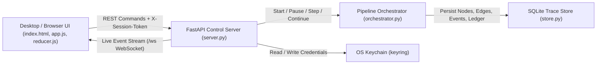
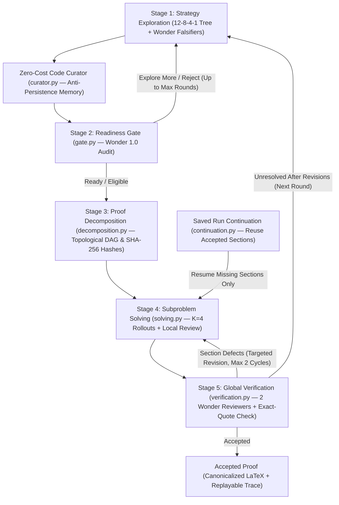
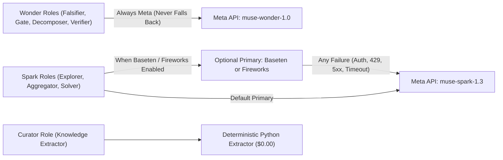

# Mini-Colosseum

Mini-Colosseum is a local research workbench for theorem proving and structured mathematical/CS problem solving. It orchestrates a deterministic 5-stage multi-agent pipeline (**Strategy Exploration → Readiness Gate → Proof Decomposition → Subproblem Solving → Global Verification**) powered by Meta Muse models (`muse-spark-1.3` and `muse-wonder-1.0`), with optional **Baseten** and **Fireworks** acceleration that automatically falls back to the Meta API on any failure.

---

## Quick Start

### 1. Prerequisites
- **Python 3.10+**
- **Meta API Key** (required — validates access to `muse-spark-1.3` and `muse-wonder-1.0`)
- **Baseten API Key** *(optional)* — tried first on Spark roles (`meta-models/muse-spark-open-1026`); falls back to Meta on any error
- **Fireworks API Key** *(optional)* — tried first on Spark roles (`accounts/fireworks/models/llama-v3p3-70b-instruct`); falls back to Meta on any error
- **Node.js & npm** *(optional)* — only needed if launching inside the Electron desktop shell

### 2. Install & Launch

```bash
# Windows: install dependencies
py -m pip install -r requirements.txt

# macOS / Linux: install dependencies
python3 -m pip install -r requirements.txt
```

| Mode | OS | Command | Description |
| :--- | :--- | :--- | :--- |
| **Windows Launcher** | Windows | `run.bat` (or double-click) | Starts the backend on port `8765` and opens your browser automatically |
| **POSIX Launcher** | macOS / Linux | `./run.sh` | Starts the backend with health check and opens `http://127.0.0.1:8765` |
| **Direct CLI** | All | `python -m backend.main 8765` | Starts the local server directly; open `http://127.0.0.1:8765` in any browser |
| **Electron Desktop** | All | `npm install && npm start` | Opens the native Electron desktop window |

---

## How to Use Mini-Colosseum (Step-by-Step)

### Step 1: Connect Your API Keys
When you first open Mini-Colosseum (or click **`⚙ Keys`** in the toolbar), the **Connect your model providers** modal appears:
1. **Meta API Key (Required):** Paste your Meta key. When you click **Save & Connect**, the server verifies live access to both `muse-spark-1.3` and `muse-wonder-1.0`.
2. **Baseten / Fireworks Keys (Optional):** Paste either key and check **Enable Baseten** or **Enable Fireworks** if you want Spark drafting/solving roles to try those providers first. If verification or any runtime call fails on Baseten or Fireworks, Mini-Colosseum automatically falls back to your Meta key without interrupting the run.
3. Keys are stored in your **OS Keychain** (`keyring`) and are never written to SQLite databases, logs, or exported traces.
4. Once connected, the top bar displays live provider states: `Meta [ACTIVE] · Baseten [ACTIVE/OFFLINE] · Fireworks [ACTIVE/OFFLINE]`.

---

### Step 2: Enter a Problem & Configure the Run
You can start a run in two ways:

- **Quick Run (Top Bar):**
  Type or paste your problem into the **`Problem statement (maths or CS)`** input bar at the top and click **`▶ Run All`** (or press `F5`).

- **Full Problem & Attachment Setup (`Problem` button or `Ctrl+N`):**
  Click **`Problem`** in the toolbar (or `File → New Run / Custom Problem...`) to configure:
  - **Problem statement:** Multi-line plain text, LaTeX, or Markdown.
  - **Attach documents:** Drag and drop `.pdf`, `.docx`, or `.tex` files (up to 20 MB each) to include reference papers or definitions in the prompt context.
  - **Budget cap (USD):** Hard spending limit for the run (default **`$50.00`**; auto-stops if reached).
  - **Max Rounds:** Maximum outer exploration/re-exploration rounds (default **`15`**, up to `20`).
  - **Tree Widths:** Width of each exploration tree level from leaves to root (default **`12, 8, 4, 1`**).
  - **Sample / Rollout K:** Number of parent candidates sampled during aggregation and parallel writer rollouts per proof section (default **`4`**).
  - Click **`Run Proof Engine`** to launch immediately, or **`Save Setup`** to stage the configuration.

---

### Step 3: Control Execution & Navigate the Workspace
Use the toolbar buttons or keyboard shortcuts during a live run or offline replay:

| Button | Shortcut | Action |
| :--- | :--- | :--- |
| **`▶ Run All`** | `F5` | Start a new run, resume a paused run, or play a loaded trace |
| **`⏭ Step`** | `Ctrl+Right` / `Ctrl+Down` | Advance one stage/node at a time (live step mode or replay) |
| **`⏮ Back`** | `Ctrl+Left` | Step backward one event in offline replay mode |
| **`⏩ End`** | `Ctrl+End` | Fast-forward replay to the final recorded event |
| **`⏸ Pause`** | `F6` | Pause execution after current in-flight model calls finish |
| **`⏹ Stop`** | `Shift+F5` | Immediately cancel the active run |
| **`🔄 Re-explore`** | `Ctrl+R` / `Ctrl+E` | Force a new exploration round carrying forward prior critiques |

#### Understanding the Three Workspace Panes

1. **Left Pane — Graph & Script Views** *(switch via toolbar `📄 Script`, `🌲 Tree`, `📊 DAG` or the top tabs)*
   - **`🌲 Research Map` (`Tree`):** Visualizes Stage 1 & Stage 2. Watch leaf explorers (`S1`–`S12`) get attacked by Wonder falsifiers (`F:OK`, `F:repair`, `F:reject`), synthesized through overlapping aggregator layers (`A1`–`A8` → `B1`–`B4` → `ROOT`), curated (`EXTRACTOR_1`), and audited by the Readiness Gate (`GATE_1`).
   - **`📊 Dependency Map` (`DAG`):** Visualizes Stage 3, Stage 4, & Stage 5. Displays the topological subproblem DAG (`DEC_1` → `SEC_1`..`SEC_k` → `VERIF_1`) with Danus SHA-256 fingerprint badges (`d:hash`), parallel rollout badges (`K=4`), retry badges (`retry:1`), and dynamic `STALE` / `INVALIDATED` indicators when upstream sections change.
   - **`📄 proof.v (Proof document)` (`Script`):** Displays the assembled proof script with line numbers and green highlighting for verified sections.
   - *Tip:* Use the **`Fit`** and **`1:1`** buttons in the bottom-right corner of the graph canvas (or scroll/drag) to zoom and pan.

2. **Center Pane — `Proof preview`**
   - Shows a clean, human-readable mathematical rendering of your problem statement and the assembled LaTeX proof as sections complete.

3. **Right Pane — Node Inspector (Top) & Console (Bottom)**
   - **Click any node** in the `Tree` or `DAG` to inspect it across 6 tabs:
     - **`Sections`:** Displays 4 quick-summary cards for the selected node:
       1. *(1/4) Problem target*
       2. *(2/4) Proposed approach*
       3. *(3/4) Review result*
       4. *(4/4) Open issues*
       *(Click any of the 4 rows to jump directly to its detailed tab.)*
     - **`Details`:** Model, provider, fallback status, token counts, USD cost, structured `<analysis>` (`available_info`, `plan`, `uncertainties`), and input/output summaries.
     - **`Review`:** Full Wonder 1.0 falsifier critique, categorized objections, and individual `K=4` solver rollout drafts.
     - **`Verification`:** Stage 5 Global Verification verdict from 2 independent Wonder 1.0 reviewers with DeepSeekMath-V2 exact-quote verification status.
     - **`Revision History`:** HMED records (`failed_draft`, `critique`, `revised_draft`, `downstream_verdict`) from local retries and targeted revisions.
     - **`Reference Notes`:** Unrefuted claims, failed approaches, and problem invariants extracted deterministically across rounds.
   - **`Console & Execution Events` (Bottom-Right):** Real-time event log with keyword search (`Search logs...`) and severity filter (`All`, `Info`, `Warnings`, `Errors`).

---

### Step 4: Cost Ledger, Saved Runs, Continuation, & Export

- **Inspect Per-Node Costs (`Ledger` button):**
  Opens the **Run Ledger** modal showing every step's stage, node label, model used, USD cost, and percentage share of total run spend. Click the **`Cost (USD)`** column header to sort by most expensive nodes.
- **Replay or Continue Previous Runs (`📂 History` button or `Ctrl+O`):**
  - **Replay:** Click any saved run to reload its complete node graphs, proof script, and event log offline with zero API calls.
  - **Continue an Interrupted Run (`Continue` button):** If a run was stopped, cancelled, or hit its budget cap *after* Stage 3 (Decomposition), click **`Continue`** next to that run in `History`. Mini-Colosseum reuses all already-accepted section bodies, solves only the remaining missing sections, and runs Stage 5 verification under your updated budget cap.
  - **Import `.jsonl`:** Click **`Import a saved run`** inside `History` to load an exported `.jsonl` event trace from disk.
- **Export Results (`Export:` dropdown in toolbar):**
  - **`Proof (LaTeX)`** — Canonicalized, `pdflatex`-ready `.tex` document
  - **`Report (Markdown)`** — Markdown report with problem statement and assembled LaTeX proof
  - **`Ledger (CSV)`** — Spreadsheet of step-by-step model costs and run shares
  - **`Run trace (JSON)`** — Full replayable run state (nodes, edges, events, knowledge, HMED records)

---

## Architecture Overview

Instead of a single crowded diagram, the architecture is split into three focused views: **System Components**, **5-Stage Proof Pipeline**, and **Model Routing & Fallback**.

### 1. System Components & Data Flow



### 2. The 5-Stage Proof Pipeline & Revision Loops



### 3. Model Routing & Automatic Meta Fallback



---

## Repository Structure

| Path | Role |
| :--- | :--- |
| [`backend/main.py`](backend/main.py) | CLI entry point launching Uvicorn on `127.0.0.1` (default port `8765`) |
| [`backend/server.py`](backend/server.py) | FastAPI REST & WebSocket server, session-token security middleware, provider verification, continuation, and exports |
| [`backend/config.py`](backend/config.py) | Provider URLs, pricing tables, budget caps (`$50` run, `$150` Meta, `$100` Baseten/Fireworks), role routes, and token caps |
| [`backend/client.py`](backend/client.py) | Async OpenAI-compatible client, atomic in-flight budget reservations, retry/backoff, schema validation, and Meta fallback |
| [`backend/models.py`](backend/models.py) | Pydantic schemas for nodes, edges, events, strategies, falsifier reports, DAG plans, and verification reports |
| [`backend/store.py`](backend/store.py) | SQLite persistence for runs, nodes, edges, events, knowledge entries, raw provenance, and HMED records |
| [`backend/pipeline/orchestrator.py`](backend/pipeline/orchestrator.py) | Deterministic 5-stage state machine, pause/step/stop controls, targeted section revision, and re-exploration loops |
| [`backend/pipeline/exploration.py`](backend/pipeline/exploration.py) | Stage 1: Overlapping `(12, 8, 4, 1)` exploration tree with critique-preserving aggregation |
| [`backend/pipeline/curator.py`](backend/pipeline/curator.py) | Stage 1.5: Zero-cost deterministic extractor for failed approaches, unrefuted claims, and invariants |
| [`backend/pipeline/gate.py`](backend/pipeline/gate.py) | Stage 2: Wonder 1.0 readiness gate auditing fatal bridges and assigning obligations |
| [`backend/pipeline/decomposition.py`](backend/pipeline/decomposition.py) | Stage 3: Topological subproblem DAG builder, cycle detector/repair, and Danus SHA-256 fingerprinting |
| [`backend/pipeline/solving.py`](backend/pipeline/solving.py) | Stage 4: `(K, 1)` parallel section writers, per-draft falsifiers, local retries, and stale dependent re-review |
| [`backend/pipeline/verification.py`](backend/pipeline/verification.py) | Stage 5: Dual independent Wonder 1.0 global reviewers with DeepSeekMath-V2 verbatim quote verification (`>= 12` chars) |
| [`backend/pipeline/continuation.py`](backend/pipeline/continuation.py) | Rebuilds a continuation seed from saved traces so interrupted runs resume only missing sections |
| [`backend/pipeline/latex_utils.py`](backend/pipeline/latex_utils.py) | Deterministic JSON/LaTeX escape repair, truncated JSON field recovery, and Unicode-to-LaTeX sanitization |
| [`frontend/index.html`](frontend/index.html) | Desktop/browser workbench UI layout, modals, and inspector tabs |
| [`frontend/js/app.js`](frontend/js/app.js) | Frontend controller, WebSocket event handler, replay engine, ledger, continuation, and export actions |
| [`frontend/js/graph_renderer.js`](frontend/js/graph_renderer.js) | Interactive SVG renderer for the Research Tree and Proof DAG |
| [`frontend/js/dagre_layout.js`](frontend/js/dagre_layout.js) | Hierarchical layered graph layout engine |
| [`frontend/js/katex_simple.js`](frontend/js/katex_simple.js) | Coq/LaTeX script formatter and readable math preview renderer |
| [`frontend/js/reducer.js`](frontend/js/reducer.js) | Pure functional event reducer (`reduceReplayEvents`) for offline trace replay |
| [`electron/main.js`](electron/main.js) | Electron main process managing the Python backend lifecycle and desktop window |

---

## Security & Privacy
- **Loopback-Only Binding:** The backend binds strictly to `127.0.0.1` and rejects external `Host` or cross-origin headers.
- **Per-Launch Session Token:** Every REST and WebSocket request requires the active `X-Session-Token` generated at launch.
- **OS Keychain Storage:** API keys are stored via the OS keychain (`keyring`) and masked in all settings responses.
