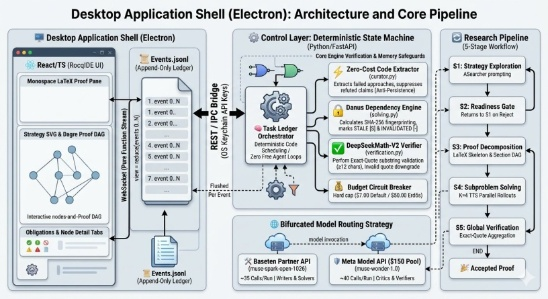

# Mini-Colosseum

Mini-Colosseum is a local research workbench for running a multi-stage inference pipeline against Meta models, with optional Baseten and Fireworks providers that fall back to Meta on any failure and a desktop/browser UI for interactive runs, exports, and replay.

It is designed for theorem-style and proof-oriented workflows: a user supplies a problem, the system explores possible strategies, decomposes the task, solves subproblems, verifies claims, and emits structured outputs and provenance.

## Architecture



*Architecture overview from the design context: Electron/browser shell, FastAPI control layer, deterministic pipeline (exploration → gate → decomposition → solving → verification), and bifurcated model routing (Meta primary, Baseten/Fireworks optional, Meta fallback).*

The project has four main layers:

1. **Desktop/browser client**
   - Electron shell in [electron/main.js](electron/main.js)
   - Static UI served from [frontend/index.html](frontend/index.html) and [frontend/js](frontend/js)
   - The front end renders the run tree, events, settings, and export/replay actions. Its layout is unchanged from the reference UI.

2. **FastAPI backend**
   - Entry point: [backend/main.py](backend/main.py)
   - API and WebSocket server: [backend/server.py](backend/server.py)
   - Stores runs and event history in SQLite via [backend/store.py](backend/store.py)
   - Provides health checks, session validation, runtime configuration, and provider verification endpoints

3. **Inference and routing layer**
   - Provider abstractions and retry logic: [backend/client.py](backend/client.py)
   - Model URLs, provider configuration, and pricing caps: [backend/config.py](backend/config.py)
   - Shared data models and run schemas: [backend/models.py](backend/models.py)

4. **Research/pipeline engine**
   - Main orchestration and lifecycle: [backend/pipeline/orchestrator.py](backend/pipeline/orchestrator.py)
   - Stages include exploration, gate checking, decomposition, solving, verification, and curation:
     - [backend/pipeline/exploration.py](backend/pipeline/exploration.py)
     - [backend/pipeline/gate.py](backend/pipeline/gate.py)
     - [backend/pipeline/decomposition.py](backend/pipeline/decomposition.py)
     - [backend/pipeline/solving.py](backend/pipeline/solving.py)
     - [backend/pipeline/verification.py](backend/pipeline/verification.py)
     - [backend/pipeline/curator.py](backend/pipeline/curator.py)

### Runtime flow

1. The user launches the app or local backend.
2. The backend starts a FastAPI server on 127.0.0.1 with a session token.
3. On startup the UI asks for a **Meta API Key** (required) and, optionally, **Baseten** and **Fireworks** keys.
4. The frontend connects to the WebSocket and submits a run request. No problem is pre-selected and no input is pre-filled.
5. The orchestrator creates a run record and executes the pipeline stages.
6. Each stage emits events such as node creation, route selection, budget usage, and verification status.
7. If a Baseten or Fireworks key fails for any reason (auth, rate limit, timeout, or server error), the call falls back to the Meta API key.
8. The run can stop when reaching a budget cap, fail a validation gate, or complete successfully.
9. The UI can replay saved runs and export proofs, reports, traces, and ledger data.

## Directory layout

- [backend](backend): API server, store, client, models, pipelines, and orchestration
- [frontend](frontend): static HTML/CSS/JS for the web UI
- [electron](electron): Electron shell for packaged desktop usage
- [docs](docs): architecture diagram and project documentation assets
- [tests](tests): backend provider/fallback tests
- [run.bat](run.bat): Windows one-click launcher
- [run.sh](run.sh): POSIX launcher for macOS/Linux
- [package.json](package.json): Node scripts and Electron packaging config
- [requirements.txt](requirements.txt): Python backend dependencies

## Prerequisites

- **Python 3.10+**
- **Meta API Key** (required: `META_API_KEY` or `MODEL_API_KEY` for Muse Spark 1.3 & Muse Wonder 1.0)
- **Optional Baseten API Key** (`BASETEN_API_KEY`, tried first on Spark roles; any failure falls back to Meta)
- **Optional Fireworks API Key** (`FIREWORKS_API_KEY`, tried first on Spark roles; any failure falls back to Meta)
- *Optional:* **Node.js & npm** (only needed for the Electron desktop wrapper)

## How to run

Install Python dependencies first:

```bash
# Windows
py -m pip install -r requirements.txt

# macOS / Linux
python3 -m pip install -r requirements.txt
```

| Launcher | OS | How to run | Notes |
| :--- | :--- | :--- | :--- |
| `run.bat` | Windows | Double-click or `run.bat` | Simplest Windows path |
| `run.sh` | macOS / Linux | `./run.sh` | POSIX script with readiness check |
| Direct CLI | All | `python -m backend.main 8765` | Browser mode, no wrappers |
| `npm start` | All | `npm start` | Electron window (requires `npm install` first) |

Then navigate to **http://127.0.0.1:8765** in any modern web browser.

## Configuration and provider setup

When you first launch Mini-Colosseum, the onboarding modal prompts for API credentials:

1. **Meta API Key**: Required. Validates access to `muse-spark-1.3` (exploration and drafting) and `muse-wonder-1.0` (falsification, gate, and verification).
2. **Baseten API Key**: Optional. When configured, eligible Spark requests can use Baseten's `meta-models/muse-spark-open-1026`. If the Baseten key fails for any reason, calls automatically fall back to the Meta API key.
3. **Fireworks API Key**: Optional. When configured, eligible Spark requests can use Fireworks. If the Fireworks key fails for any reason, calls automatically fall back to the Meta API key.
4. **Keychain security**: Valid keys are saved into the local OS keychain. Raw keys are never stored in SQLite run traces, logs, or exports.

Muse Wonder always stays on Meta. Baseten and Fireworks are never used for Wonder calls, and Meta never falls back to Baseten or Fireworks: Meta is the only fallback target.

## Running tests

```bash
# Backend provider/fallback tests
python -m pytest

# Frontend state reducer unit tests
node frontend/js/reducer.test.js
```

## Problem input and output

The app accepts human-readable problem statements and can ingest plain text, Markdown, LaTeX, and PDF/DOC/DOCX/TEX attachments. Runs also support replay of prior execution history, export of proofs/reports/CSV ledgers/JSON traces, and budget-aware stopping based on configured caps.

## Security model

Mini-Colosseum keeps local execution constrained to loopback interfaces and validates a per-launch session token for app traffic. This protects the local UI and backend from cross-origin or external misuse while still allowing the browser or Electron app to connect to the same machine.

## Notes for contributors

- The pipeline uses fixed internal sampling and rollout constants, which are intentionally not exposed as user-facing runtime settings.
- Provider routing is explicit and model-aware; output tokens and reasoning parameters are capped and normalized per role.
- The project expects the backend and frontend to run in a local, loopback-only environment rather than as a public multi-user service.


